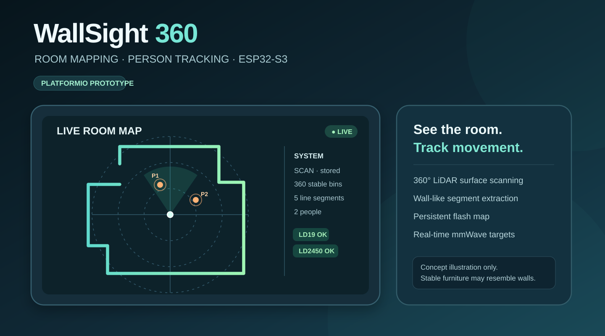
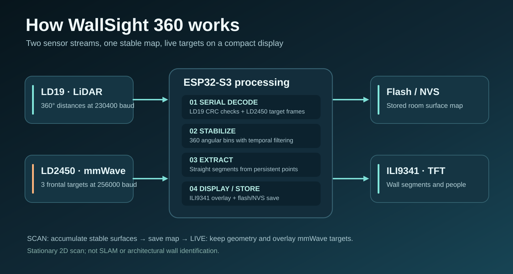
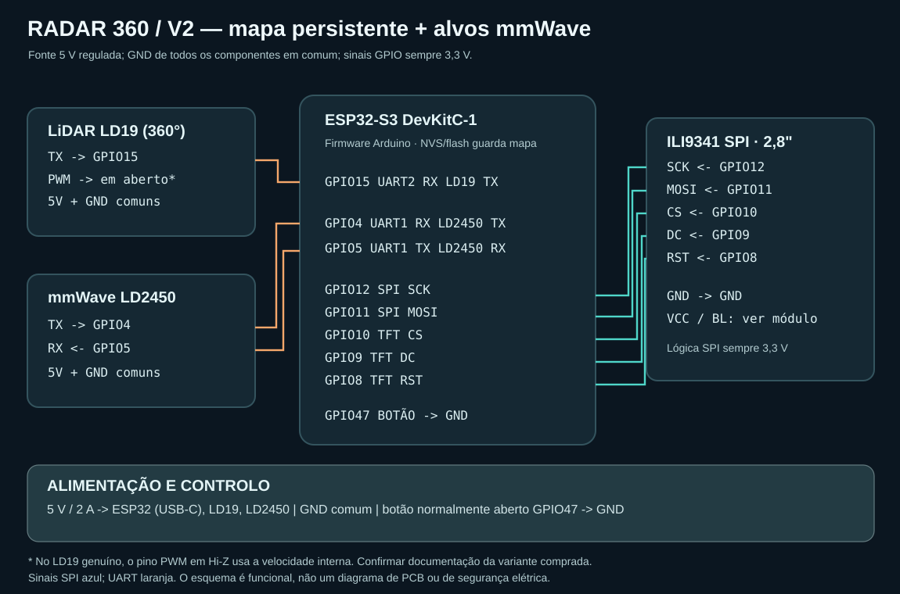
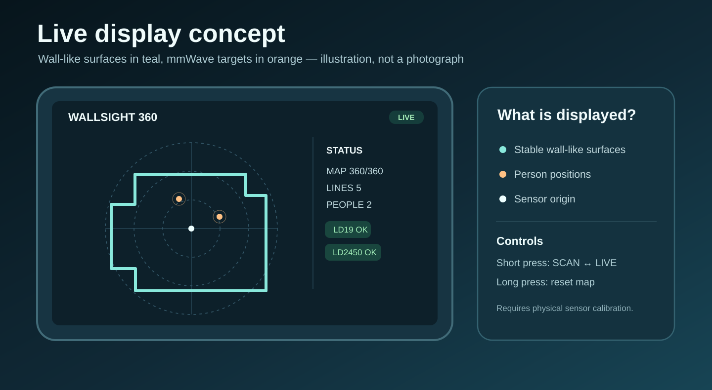

# WallSight 360

**Map your room outline with LiDAR and track motion with mmWave.**

> Experimental indoor radar built with ESP32-S3, LD19 LiDAR, HLK-LD2450 mmWave and a TFT display. It detects *wall-like stable surfaces*, saves the map and overlays up to three mmWave targets in real time.

[](https://platformio.org/) [](LICENSE)

---

## Visual overview



WallSight 360 combines a **360° LiDAR** for room surface measurements, a **frontal mmWave radar** for person positioning, and an **ESP32-S3** that fuses the data, saves the map to flash and draws everything on an **ILI9341** display.



**Version 0.2 · PlatformIO · Experimental prototype · ESP32-S3 DevKitC-1 N8R8 + LDROBOT LD19 + HLK-LD2450 + SPI ILI9341 320×240 TFT**

This project maps the visible outline of a room, extracts **straight wall-like segments**, stores the map in flash memory and overlays up to three mmWave targets on top of it. The LiDAR is stationary: there is no SLAM, no sensor movement, no guaranteed wall classification and no 360° human mmWave detection.

## 1. Bill of materials

| Item | Qty. | Notes |
|---|---:|---|
| ESP32-S3 DevKitC-1 **N8R8** | 1 | 8 MB flash / 8 MB PSRAM |
| LDROBOT **LD19** with 4-wire cable | 1 | Genuine LD19; 5 V power; 3.3 V TTL UART at 230400 baud |
| Hi-Link **HLK-LD2450** | 1 | 5 V power; 3.3 V TTL UART at 256000 baud |
| ILI9341 **SPI** 2.8" 320×240 | 1 | Use an SPI module with 3.3 V logic (not the parallel variant) |
| Normally-open push button | 1 | One side to GPIO47, the other to GND |
| 5 V / 2 A supply and 5 V distribution | 1 | Stable power; protect against reverse polarity |
| Wires, connectors, non-metal enclosure | — | Include the proper LD19 cable |

The ILI9341 name only identifies the controller, and modules with the same controller may have **different VCC/LED/backlight requirements**. Check your exact module before powering VCC or the backlight. Never apply 5 V directly to ESP32 GPIO pins.

## 2. Wiring

| Source | Destination | Notes |
|---|---|---|
| LD19 TX | ESP32 GPIO15 | UART2 RX, receive only |
| LD19 PWM | **Leave open (Hi-Z)** | Genuine LD19 uses internal motor control; verify your variant |
| LD19 P5V | 5 V supply | Regulated 5 V rail |
| LD19 GND | Common GND | — |
| LD2450 TX | ESP32 GPIO4 | UART1 RX |
| LD2450 RX | ESP32 GPIO5 | UART1 TX, 3.3 V |
| LD2450 5V | 5 V supply | Regulated 5 V rail |
| LD2450 GND | Common GND | — |
| TFT SCK / CLK | ESP32 GPIO12 | SPI clock |
| TFT SDI / SDA / MOSI | ESP32 GPIO11 | SPI data |
| TFT CS | ESP32 GPIO10 | — |
| TFT DC / RS | ESP32 GPIO9 | — |
| TFT RST | ESP32 GPIO8 | — |
| TFT VCC | 3.3 V **if supported** | Confirm your exact module |
| TFT GND | Common GND | — |
| TFT LED / BL | Follow TFT documentation | Some modules need current limiting |
| TFT MISO / SDO | Not connected | Not required by this firmware |
| Button | GPIO47 + GND | INPUT_PULLUP, no external resistor needed |

Use a single regulated 5 V supply and proper power distribution (USB-C to the ESP32 and 5 V rails to the sensors). Do not parallel multiple 5 V sources without isolation, and do not try to power both sensors from the ESP32 3V3 pin. All grounds must be common.



Mount the LD19 horizontally with a clear 360° line of sight. Mount the LD2450 on the same base and point its frontal axis to the 0° direction used by the map. Ideally place the LiDAR at the height of the vertical surfaces you want to measure, avoiding chair/table/sofa legs crossing the scan plane.

## 3. PlatformIO — build, flash and serial monitor

**This firmware project is fully structured for PlatformIO**, not the Arduino IDE. The firmware uses Arduino as the *framework*, but dependency management, build and upload are all handled by PlatformIO.

Project structure:

```text
wallsight-360/
├── platformio.ini
├── src/
│   └── main.cpp
├── include/
│   ├── radar_protocol.h
│   └── wall_map.h
├── assets/
│   ├── hero-radar-map.svg
│   ├── system-overview.svg
│   └── ui-live-screen.svg
├── tests/
│   ├── protocol_tests.cpp
│   └── map_tests.cpp
├── esquema_ligacoes.svg
├── README.md
└── README_EN.md
```

In VS Code, install the **PlatformIO IDE** extension, open this folder as a project and use **Build** / **Upload** / **Monitor**, or run:

```bash
pio run -e esp32s3-n8r8
pio run -e esp32s3-n8r8 -t upload
pio device monitor -b 115200
```

The configuration targets an **ESP32-S3-WROOM-1 N8R8** (8 MB QIO flash + 8 MB OPI PSRAM), using `board_build.arduino.memory_type = qio_opi`, PSRAM build flags and the **native USB** port for serial monitoring. If you use the USB-UART port instead of native USB, change `ARDUINO_USB_CDC_ON_BOOT=0`. You may also need to set `upload_port` / `monitor_port` explicitly.

PlatformIO automatically installs `Adafruit GFX Library`, `Adafruit ILI9341` and `Adafruit BusIO` through `lib_deps`.

**Status:** the portable C++ logic tests ran successfully without hardware. `pio run` could not be executed in this environment because the PlatformIO CLI is not installed here. The ESP32-S3 build and real hardware validation still need to be checked.

## 4. Interface — modes



### SCAN (first use)

- If no saved map exists, the device boots in `SCAN`.
- The LiDAR acquires distance measurements and distributes them across **360 one-degree bins**.
- A new surface is only accepted after compatible observations across several passes; changes to already-known walls require many more observations before replacing the saved geometry.
- mmWave-detected people are excluded from the map within a radius of about 50 cm, **after calibration**.
- Straight segments longer than 85 cm, with continuity and limited geometric deviation, are drawn in a brighter color. They are **wall candidates**, but may also represent cabinets or other furniture.
- Keep the sensor still until a good portion of the room becomes stable. **Short press the button:** save the map to flash and switch to `LIVE`.

### LIVE

- The LiDAR remains powered and streaming, but the saved map stops changing.
- Up to three mmWave targets are drawn on top of the same XY reference frame, corrected by angular calibration and offsets.
- **Short press:** go back to `SCAN`, preserving the current map for later improvement.
- **Long press (2.5 s):** erase the saved map and start a new `SCAN`.
- When a valid saved map exists, the system boots directly into `LIVE`.

**Serial monitor commands:** `s` = save map / switch mode; `n` = erase and restart scan; `e` = export the **360 distance values (mm)** as JSON between `MAP_JSON_BEGIN` and `MAP_JSON_END`. The export contains surface points, not editable architectural polygons.

## 5. Sensor calibration

At the top of `src/main.cpp`:

```cpp
constexpr float LIDAR_ROTATION_DEG=0.0f;
constexpr float RADAR_ROTATION_DEG=0.0f;
constexpr float RADAR_X_SIGN=1.0f;
constexpr float RADAR_X_OFFSET_MM=0.0f;
constexpr float RADAR_Y_OFFSET_MM=0.0f;
constexpr float DISPLAY_RANGE_MM=6000.f;
```

**Procedure:**
1. Place the sensor in a room with a clear frontal wall and mark the physical front of the LD2450.
2. Confirm that the frontal wall appears at the top of the display. If not, adjust `LIDAR_ROTATION_DEG`.
3. Walk from left to right in front of the radar. If the target moves in the opposite direction on screen, change `RADAR_X_SIGN` from `1.0` to `-1.0`.
4. Adjust `RADAR_ROTATION_DEG` until the targets align with the frontal axis.
5. Measure the distance between the sensor centers and fill the X/Y offsets in millimeters.
6. **Erase the old map after changing the LiDAR rotation** (`n`), because previous measurements were stored in a different coordinate frame.

## 6. How a wall is estimated

1. LD19 frame acquisition and CRC validation (47-byte frames, 12 samples each).
2. Angle/distance → (x, y) conversion in the LiDAR plane.
3. Temporal grouping into angular bins with tolerance for measurement variation.
4. Rejection of rapid changes and points overlapping known LD2450 targets.
5. Grouping of nearby, roughly collinear points (`getSegments`).
6. Drawing line candidates on screen. The system stores a polar map, **not an architectural CAD model**.

**Important limitations:**
- The LiDAR only sees the **first reflective surface** in each direction. It cannot automatically recover walls hidden behind furniture.
- A sofa or cabinet may appear as a wall-like straight line.
- The system does not combine multiple observation positions and does not implement SLAM.
- Glass, mirrors, black objects and strong sunlight can degrade measurements.
- The HLK-LD2450 is a frontal radar (~120° field), not a 360° human tracker, and it may stop reporting completely still people.
- The LiDAR-to-person association is only **approximate**; this is not recognition, identity, or reliable occupancy counting.

## 7. Portable C++ tests

```sh
g++ -std=c++11 -O2 -Wall -Wextra -Werror -pedantic tests/protocol_tests.cpp -o /tmp/protocol_tests
/tmp/protocol_tests
g++ -std=c++11 -O2 -Wall -Wextra -Werror -pedantic tests/map_tests.cpp -o /tmp/map_tests
/tmp/map_tests
```

These tests validate LD19 CRC logic, LD2450 decoding (including its unusual sign encoding), segment extraction in a simulated rectangular room, transient change rejection and persistence checksum integrity. **They do not replace real hardware testing and calibration.**

## 8. Troubleshooting

| Problem | Check |
|---|---|
| LD19 `--` | TX→GPIO15, 5 V, GND, cable, 230400 baud, PWM behavior for your LD19 variant |
| RADR `--` | TX→GPIO4, 5 V, GND, 256000 baud, LD2450 reporting mode |
| TFT black / white | Actual SPI ILI9341 module, CS/DC/RST pins, power/backlight and 3.3 V logic |
| Few stable points | Moving obstacles, reflective surfaces, installation height, signal intensity, distance |
| Walls and targets misaligned | Rotation and offsets; restart SCAN after LiDAR rotation changes |
| Straight lines appear on cabinets | Limitation of the surface-based algorithm — not semantic segmentation |
| Button does not react | Verify a clean connection between GPIO47 and GND, never 5 V |
| Map disappears after reboot | Perform a short press to save; check NVS messages in Serial |
| Slow or flickery UI | Framebuffer may not fit; reduce refresh rate or switch to LVGL / TFT_eSPI |

## 9. Technical references

- LD19 Development Manual — https://core-electronics.com.au/attachments/localcontent/LD19_Development_Manual_v2_7895434727a.pdf
- LD19 (Waveshare Wiki) — https://www.waveshare.com/wiki/DTOF_LIDAR_LD19
- LD19 datasheet — https://raw.githubusercontent.com/May-DFRobot/DFRobot/master/LD19_Datasheet_v2.5.pdf
- LD2450 Serial Communication Protocol — https://assets.super.so/79c0d2a8-d37a-438f-8fbe-c44778f3b0dd/files/ee2aafb0-f93e-47cd-b722-ad0f9e76b6f7/LD2450_Serial_Communication_Protocol_V1.02_EN.pdf
- ESP32-S3 UART (Espressif) — https://docs.espressif.com/projects/esp-idf/en/latest/esp32s3/api-reference/peripherals/uart.html
- ESP32-S3 DevKitC-1 (Espressif) — https://docs.espressif.com/projects/esp-dev-kits/en/latest/esp32s3/esp32-s3-devkitc-1/user_guide_v1.1.html
- Adafruit ILI9341 — https://github.com/adafruit/Adafruit_ILI9341

## 10. License and project status

Distributed under the [MIT](LICENSE) license. This firmware is an **experimental prototype**, not a safety device nor a guaranteed occupancy detector. The portable protocol and processing tests ran successfully; full PlatformIO compilation and physical validation still need to be completed.